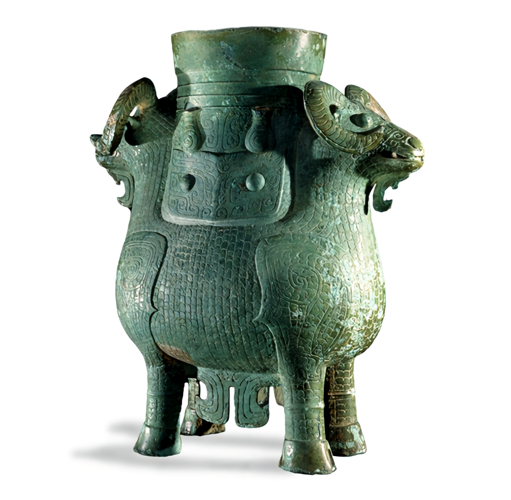
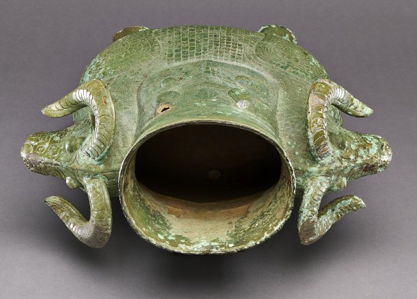
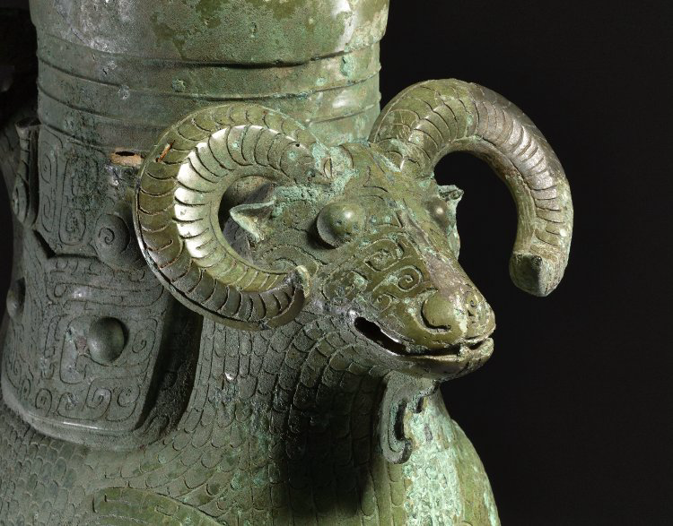
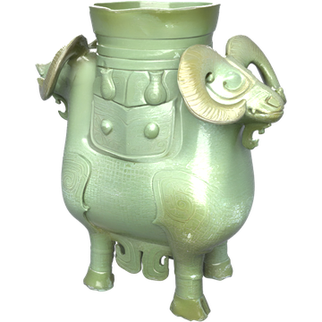
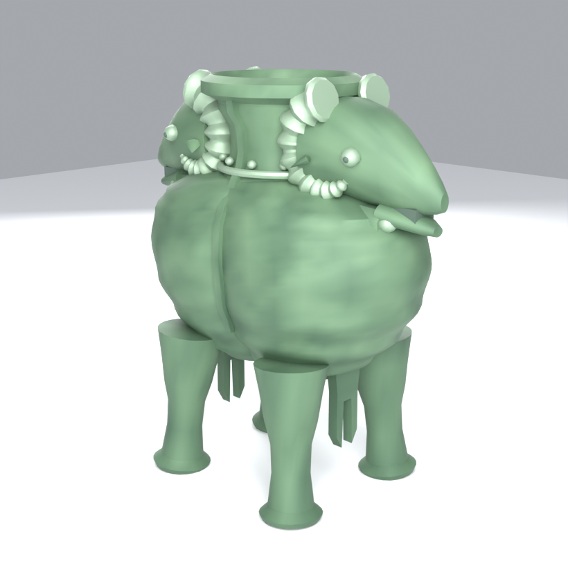

# Week 7 · Image and 3D Generation — 商代双羊尊（Double-Ram Zun）

## 1. 选定物件及其历史（An Object with a History）

- **物件**：**商代晚期青铜双羊尊**（Double-Ram Zun，约公元前 1200–1050 年）
- **现藏地**：英国大英博物馆，馆藏编号 **`1936,1118.1`**（存世仅两件，另一件藏日本东京根津美术馆，传出自湖南长沙）
- **尺寸与工艺**：高 45.1 cm、宽 41.0 cm、重 10.6 kg；器形与铸造工艺（大量使用垫片、羊角先铸后锁接）指向商代晚期长江流域（湖南一带）南方青铜传统。
- **流转史与史料边界**（详见 [docs/SOURCES.md](../../projects/thief-sim—final-project/docs/SOURCES.md) `S-001`）：
  - **可考**：原为英国收藏家 George Eumorfopoulos（1863–1939）藏品，1934–1936 年间售予大英博物馆，1936 年入藏。
  - **不可考**：Eumorfopoulos 如何取得该器、器物何时及经由何种途径离开中国、具体出土地点均无公开档案或考古发掘记录。
  - **民间传闻（非史实）**：网络流传其于 1860 年「火烧圆明园」被掠，目前无博物馆档案或学术文献支持，项目内仅标注为待考传闻，不作为史实陈述。

### 参考史料与历史照片

- 大英博物馆藏品页：<https://www.britishmuseum.org/collection/object/A_1936-1118-1>
- Wang, Q., & Priewe, S. (2013). *A Technical Study of the Double-ram Zun Ancient Chinese Bronze Vessel in the British Museum*. In K. Chen (Ed.), *Radiance between Bronze and Jade*.
- 根津美术馆同类器藏品页：<https://www.nezu-muse.or.jp/en/collection/detail.php?id=90074>

五张多角度博物馆历史参考照片存放在 [`projects/thief-sim—final-project/assets/arti-01/`](../../projects/thief-sim—final-project/assets/arti-01/)：

| 视角 | 文件 | 关键细节 |
|---|---|---|
| 全器 3/4 侧面 | [`v2-3fe98b09d1c624a6dc042085dbe27035_r.jpg.png`](../../projects/thief-sim—final-project/assets/arti-01/v2-3fe98b09d1c624a6dc042085dbe27035_r.jpg.png) | 双羊背对造型、椭圆形尊口、饕餮纹饰板、鱼鳞纹腹部、四足 |
| 俯视角度 | [`v2-2d832355f0893aa8b04bfbfd610d6237_1440w.jpg.png`](../../projects/thief-sim—final-project/assets/arti-01/v2-2d832355f0893aa8b04bfbfd610d6237_1440w.jpg.png) | 椭圆形口沿内壁、盘角对称弧度、器肩垫片痕迹 |
| 羊首与盘角特写 | [`v2-e1cb2469af1641720bb0e756a5b5d493_1440w.jpg.png`](../../projects/thief-sim—final-project/assets/arti-01/v2-e1cb2469af1641720bb0e756a5b5d493_1440w.jpg.png) | 先铸后锁接的棱纹盘羊角、乳钉眼、云雷纹鼻梁、卷须 |
| 器颈与饰板特写 | [`v2-fe1291e33e21eb0771741b4d19157511_1440w.jpg.png`](../../projects/thief-sim—final-project/assets/arti-01/v2-fe1291e33e21eb0771741b4d19157511_1440w.jpg.png) | 三道弦纹、立角突、凸目饕餮纹饰板 |
| 器腹与四足特写 | [`v2-a2e4ec5909011c10b8a4a0dcdae381e9_1440w.jpg.png`](../../projects/thief-sim—final-project/assets/arti-01/v2-a2e4ec5909011c10b8a4a0dcdae381e9_1440w.jpg.png) | 腹部鱼鳞纹、双翼卷云纹、腹底卷尾垂饰、羊蹄四足 |

| 全器 3/4 侧面 | 俯视角度 | 羊首特写 |
|---|---|---|
|  |  |  |

---

## 2. 历史参照 vs 无纹饰程序化对照（3D 生成与对比）

本项目同时制作了两条 3D 路线并进行并列对比：

1. **图生 3D 成品（基于馆藏参考照 · 腾讯混元 Hunyuan3D）**：
   - 原始模型：`e6b392eeb4fe60c7dd831782abaec83f.glb`（约 61 MB、50 万面、4K PBR 贴图）。按课程大文件规范，超过数 MB 的 `.glb` 不提交入 Git，仓库中保留其 Blender 离线渲染的 2.5D 特写与 12 帧 360° 转台图。
   - 渲染特写：[`relic_ram_zun_closeup.png`](../../projects/thief-sim—final-project/assets/sprites/relic_ram_zun_closeup.png)
   - 12 帧 360° 旋转转台：[`relic_ram_zun_ui_strip.png`](../../projects/thief-sim—final-project/assets/sprites/relic_ram_zun_ui_strip.png)
2. **纯文字/尺寸参数驱动的 Blender 程序化模型（回退对照）**：
   - 源文件与导出：[`ram_zun.blend`](../../projects/thief-sim—final-project/assets/models/ram_zun.blend)（470 KB）、[`ram_zun.glb`](../../projects/thief-sim—final-project/assets/models/ram_zun.glb)（656 KB）、脚本 [`tools/blender/build_ram_zun.py`](../../projects/thief-sim—final-project/tools/blender/build_ram_zun.py)
   - 3/4 视角预览：[`ram_zun_preview.png`](../../projects/thief-sim—final-project/assets/models/ram_zun_preview.png)

| 馆藏原照（史料基准） | 混元 3D 渲染成品（基于参考照） | Blender 程序化模型（无参考照纹饰） |
|---|---|---|
|  |  |  |

**对比观察（Step 2 回答）**：
- **基于参考照做对了什么**：混元 3D 结合馆藏照片还原了双羊尊最具辨识度的形制比例、颈部三道弦纹、正面凸目饕餮纹饰板、腹部鱼鳞纹、双翼卷云纹以及腹底对称卷尾垂饰；而纯靠参数脚本构建的 `ram_zun.glb` 虽能对齐高 45.1 cm / 宽 41.0 cm 的馆藏尺寸，但只能概括几何轮廓，缺失商代南方青铜器的细密纹饰与真实羊首神态。
- **生成器仍会「发明」或失真之处**：混元 3D 贴图整体偏光滑发亮（类似釉面质感），弱化了商代青铜真实的斑驳铜锈与铸造垫片痕迹；在参考照未直接覆盖的背面/腹底衔接处，模型仍由算法补全几何与纹理。因此项目文档明确标注其为**展示性再现，不构成考古复原**。

---

## 3. 3D 转台成品展示

12 帧 360° 离线渲染转台（由 [`tools/blender/render_relic_turntable.py`](../../projects/thief-sim—final-project/tools/blender/render_relic_turntable.py) 使用 `e6b392eeb4fe60c7dd831782abaec83f.glb` 渲染）：

---

## 4. 后续应用（Step 4）：接入历史潜行游戏管线

3D 模型并没有停留在静态展示，而是直接落地到期末项目 [`projects/thief-sim—final-project/`](../../projects/thief-sim—final-project/)（大英博物馆文物潜行与史料调查游戏）中：

- **构建期离线渲染管线**（架构决策见 [docs/DECISIONS.md](../../projects/thief-sim—final-project/docs/DECISIONS.md) `D-013`）：
  1. `blender --background --factory-startup --python tools/blender/render_relic_turntable.py` 将 50 万面混元 3D 模型等比缩放到真实馆藏比例（高 0.443 m），在统一影棚下输出 12 帧 360° 转台与高清特写；
  2. `python3 tools/gen_relic_sprite.py` 自动切分为游戏内 2D 像素展柜转台动画（[`relic_ram_zun_strip.png`](../../projects/thief-sim—final-project/assets/sprites/relic_ram_zun_strip.png)）、文物档案 2.5D 特写（[`relic_ram_zun_closeup.png`](../../projects/thief-sim—final-project/assets/sprites/relic_ram_zun_closeup.png)）与背包图标（[`artifact_ram_zun.png`](../../projects/thief-sim—final-project/assets/sprites/artifact_ram_zun.png)）。
- 完整 3D 资产说明见 [`projects/thief-sim—final-project/assets/models/README.md`](../../projects/thief-sim—final-project/assets/models/README.md)。

---

## 5. 工具分工与人工核查

| 环节 | 工具 / AI | 人工核查 |
|---|---|---|
| 史料与照片收集 | 博物馆馆藏页与学术论文检索 | 核对大英博物馆 `1936,1118.1` 尺寸、Eumorfopoulos 1936 年入藏史实，剔除「火烧圆明园被掠」等无证传闻 |
| 图生 3D | 腾讯混元 Hunyuan3D（生成 `e6b392….glb`） | 核查羊角方向、腹底垂饰与饰板比例，确认光泽失真处并在文档声明非考古复原 |
| 程序化对照与离线渲染 | Blender 5.x + Python（`build_ram_zun.py`、`render_relic_turntable.py`、`gen_relic_sprite.py`） | 统一真实尺寸比例、配置 `.gdignore` 隔离大文件、验证无 61 MB 模型时可自动回退程序化模型 |

---

## 6. 遇到的真实困难与解法

1. **61 MB / 50 万面 3D 模型无法直接放进 2D Godot 运行时与 Git 仓库**：
   - *困难*：混元 3D 导出的 `e6b392eeb4fe60c7dd831782abaec83f.glb` 体积达 61 MB，既违反课程「大文件不入 Git」规则，在 2D 像素游戏里直接加载也会导致 Godot 导入缓慢、画面风格割裂。
   - *解法*：制定决策 `D-013`——用 `.gdignore` 和 `.gitignore` 将原始大 `.glb` 留在本地构建期，通过 Blender 无头脚本离线渲染出轻量级 12 帧转台与 4K 特写 PNG 提交入库，并保留 656 KB 的 `ram_zun.glb` 作为无大资产时的自动回退。
2. **AI 3D 模型的材质「发亮失真」与历史边界**：
   - *困难*：图生 3D 输出的青铜表面偏平滑反光，容易让玩家误以为是真实考古扫描件。
   - *解法*：在 `gen_relic_sprite.py` 中对小尺寸精灵做青铜绿的分级调色以契合像素美术，同时在 `SOURCES.md` 与游戏「声明与说明」页明确区分史实档案与 AI 展示性再现。
