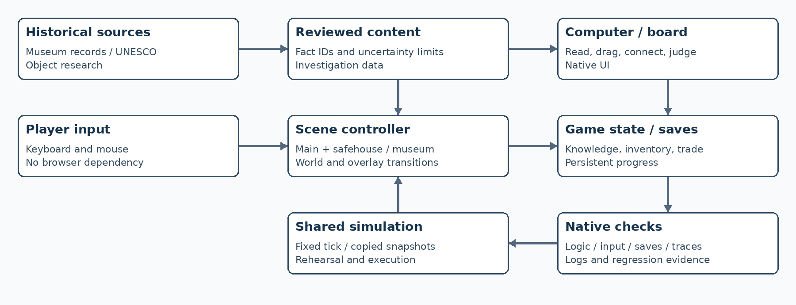

# Week 10 · Feedback Loops, Automated Testing, and Public Deployment

本项目独立仓库地址：<https://github.com/Olipias/thief-sim>  
本工作区内完整同步副本：[`projects/thief-sim—final-project/`](../../projects/thief-sim—final-project/)

## 项目简介

**《小偷模拟器》· Thief Simulator**（`v0.26.16`）是一款使用 Godot 4.7 开发的中文 2D 像素潜行与文物调查游戏。玩家在安全屋内通过电脑检索真实馆藏记录（商代双羊尊、心形圣甲虫、阿克罗蒂里彩绘注壶），完成手动证据推理后潜入展厅，使用确定性预演规划路线并决定文物归属。

## 对应 Week 10 各项要求

| Week 10 要求 | 本项目交付与入口 |
|---|---|
| **1. 规划闭环与项目架构示意图** | 规划文档：[`plan.md`](../../projects/thief-sim—final-project/plan.md)、[`docs/plan.md`](../../projects/thief-sim—final-project/docs/plan.md)、[`goal.md`](../../projects/thief-sim—final-project/goal.md)、[`AGENTS.md`](../../projects/thief-sim—final-project/AGENTS.md)<br>架构示意图：[`docs/schematic.png`](../../projects/thief-sim—final-project/docs/schematic.png) 与 [`docs/ARCHITECTURE.md`](../../projects/thief-sim—final-project/docs/ARCHITECTURE.md) |
| **2. 公开可运行分发** | 本作是原生桌面游戏（非 WebGL/浏览器应用），无需安装 Godot 即可直接运行的 Windows / Linux / macOS 三平台免安装发行包位于 [`releases/v0.26.16/`](../../projects/thief-sim—final-project/releases/v0.26.16/)（含 `SHA256SUMS.txt`）；独立源码仓库：<https://github.com/Olipias/thief-sim> |
| **3. 三层自动化测试与视觉基线闭环** | 一键验证入口：[`tools/verify.sh`](../../projects/thief-sim—final-project/tools/verify.sh)（`tools/verify.sh --visual`，共 25 个阶段全部通过）：<br>• 逻辑单测：2,552 项断言（`tests/test_logic.gd`）<br>• 史料边界测试：`pytest` 11 项（校验「据／推断／设」与出处边界）<br>• 确定性预演与真实场景：133 项；真实键鼠输入流与长文分页：563 项<br>• 安全屋经济闭环：33 项；存档兼容：135 项；视觉基线截图：56 张<br>• 测试文档与日志：[`TEST.md`](../../projects/thief-sim—final-project/TEST.md)、[`docs/qa/`](../../projects/thief-sim—final-project/docs/qa/) |
| **4. 实测反馈与防回归测试** | 反馈与人工验收记录：[`docs/user-feedback.md`](../../projects/thief-sim—final-project/docs/user-feedback.md)、[`docs/MANUAL_QA.md`](../../projects/thief-sim—final-project/docs/MANUAL_QA.md)；相关修复均写入自动化测试并在 [`CHANGELOG.md`](../../projects/thief-sim—final-project/CHANGELOG.md) 与 [`docs/DECISIONS.md`](../../projects/thief-sim—final-project/docs/DECISIONS.md) 留痕 |



## 一键运行与测试命令

```bash
cd projects/thief-sim—final-project
godot .                                        # 启动游戏（Godot 4.7）
tools/verify.sh --visual                       # 25 阶段全量自动化测试 + 视觉基线
tools/verify.sh --fast                         # 快速子集验证
godot --headless --script tests/test_logic.gd   # 纯逻辑单测
```
